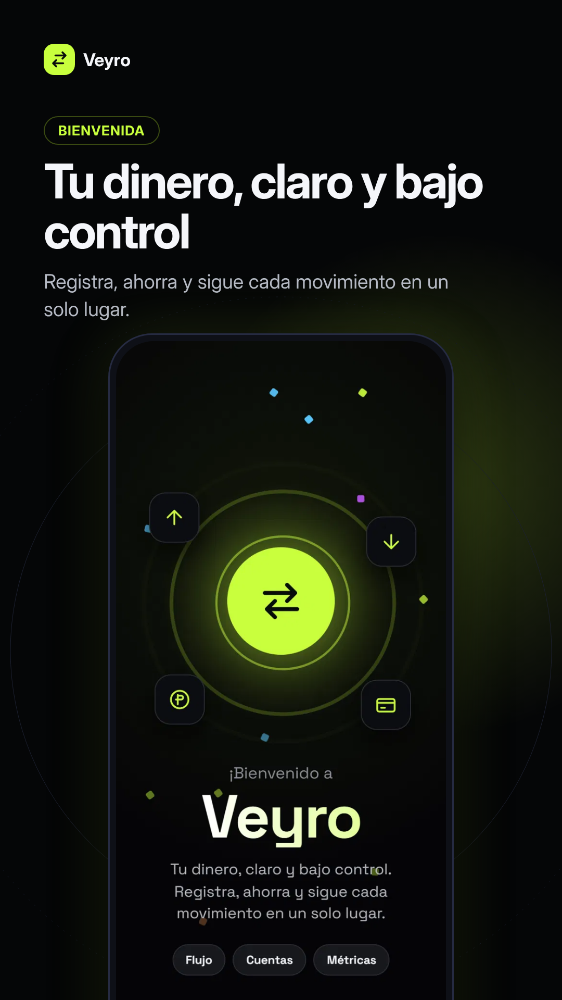
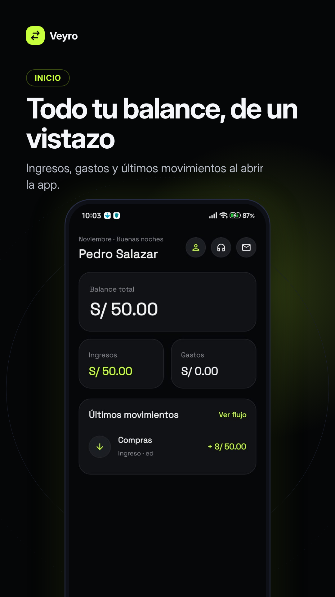
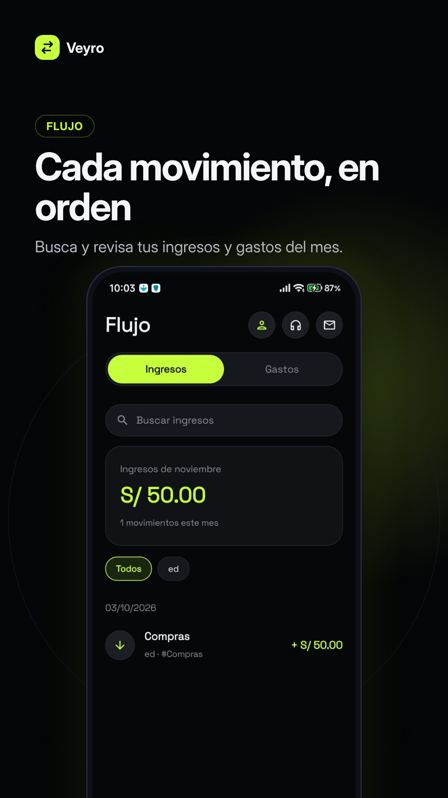
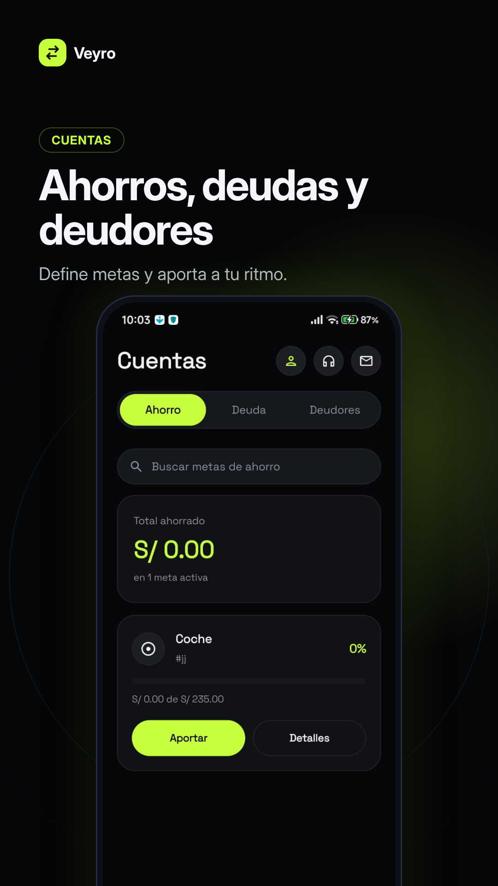
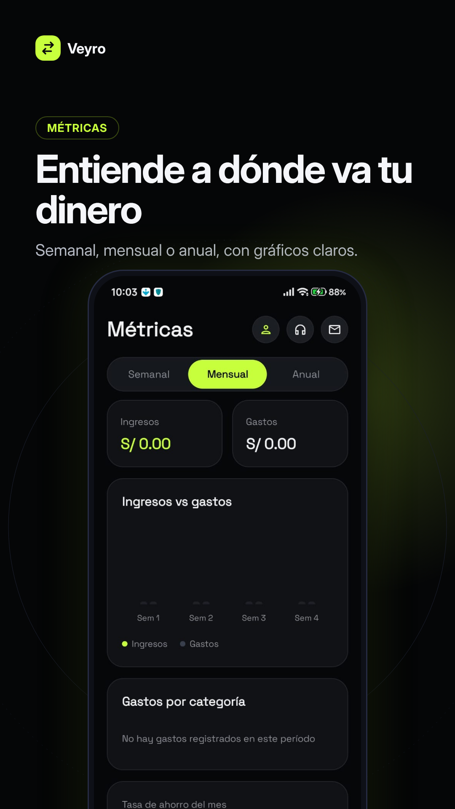
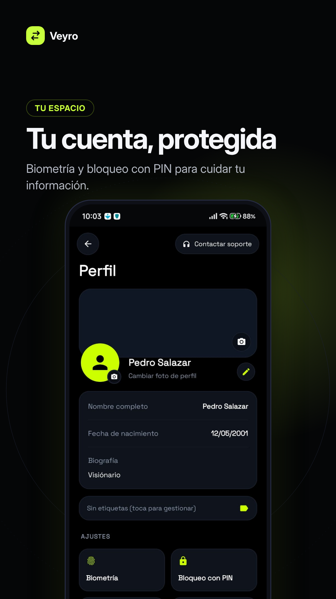
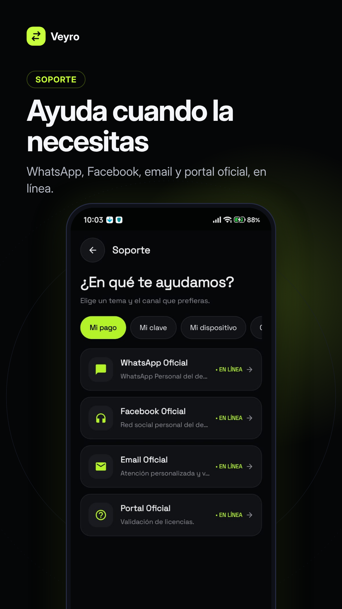
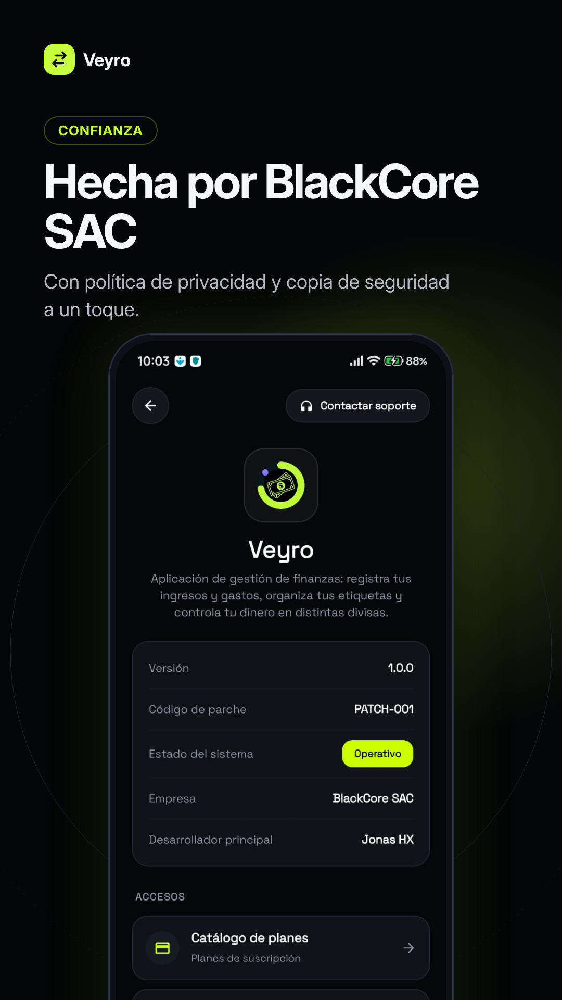

# Veyro

  

<h3 align="center">Gestiona tus finanzas. Organiza tu dinero. Toma el control.</h3>

  Una experiencia moderna para la gestión y organización de tus finanzas personales.

  
  
  

---

## Acerca de Veyro

Veyro es una aplicación de gestión financiera diseñada para ayudar a las personas a organizar, administrar y realizar un seguimiento de sus finanzas personales desde un solo lugar.

Su objetivo es ofrecer una experiencia sencilla, moderna e intuitiva que facilite la administración del dinero y permita tener una visión más clara de la actividad financiera.

## Características principales

- **Gestión financiera:** administración y organización de las finanzas personales.
- **Control de movimientos:** seguimiento de la actividad financiera.
- **Organización:** información presentada de forma clara y estructurada.
- **Experiencia intuitiva:** interfaz moderna y fácil de utilizar.

> Las características y funcionalidades se actualizarán conforme evolucione el desarrollo de Veyro.

---

## Capturas de pantalla

Explora la interfaz y las diferentes secciones de Veyro.

<table>
  <tr>
    <td></td>
    <td></td>
    <td></td>
    <td></td>
    <td></td>
    <td></td>
    <td></td>
    <td></td>
    <td></td>
  </tr>
</table>

---

## Información de la aplicación

| Información | Detalles |
|---|---|
| Nombre | Veyro |
| Categoría | Finanzas |
| Plataforma | Android |
| Versión actual | 1.0.0 |
| Desarrollador | Black Core S.A.C. |
| Idiomas | Español, Inglés, Chino, Japonés y Ruso |
| Distribución | Android - BlackCoreSAC |

## Disponibilidad

Descarga Veyro y conoce más sobre la aplicación a través de sus canales oficiales.

  

  <strong>Versión actual: 1.0.0</strong>

### Historial de versiones

| Versión | Código de parche | Tipo | Descripción |
|---|---|---|---|
| 1.0.0 | PATCH-001 | Lanzamiento inicial | Primera versión oficial de Veyro. |

---

## Enlaces oficiales

Conoce más sobre Veyro y mantente informado a través de nuestros canales oficiales.

  
  
  
  

## Soporte y contacto

¿Tienes alguna consulta, sugerencia o deseas informar sobre algún problema relacionado con Veyro?

Nuestro equipo de soporte está disponible a través de los siguientes medios:

  
  

- **Correo electrónico:** Black.Core.SAC@gmail.com
- **Teléfono de contacto:** +51 915 345 098

## Privacidad

La privacidad y la seguridad de la información forman parte de los aspectos importantes del desarrollo de Veyro.

Consulta nuestra política de privacidad para conocer más sobre el tratamiento de la información y las condiciones relacionadas con el uso de la aplicación.

  

---

## Licencia y derechos de autor

**Copyright © 2026 Veyro. Todos los derechos reservados.**

Veyro es un producto de Black Core S.A.C.

Queda reservada la totalidad de los derechos sobre la identidad, marca y elementos propios de Veyro, salvo autorización expresa de sus titulares.
